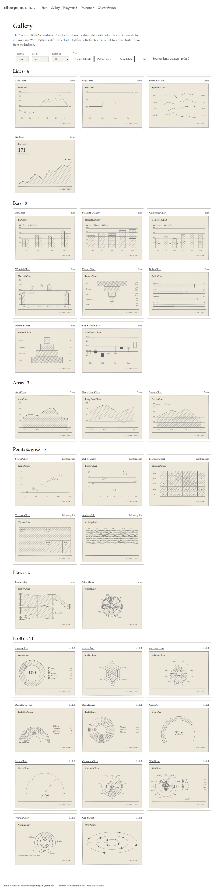
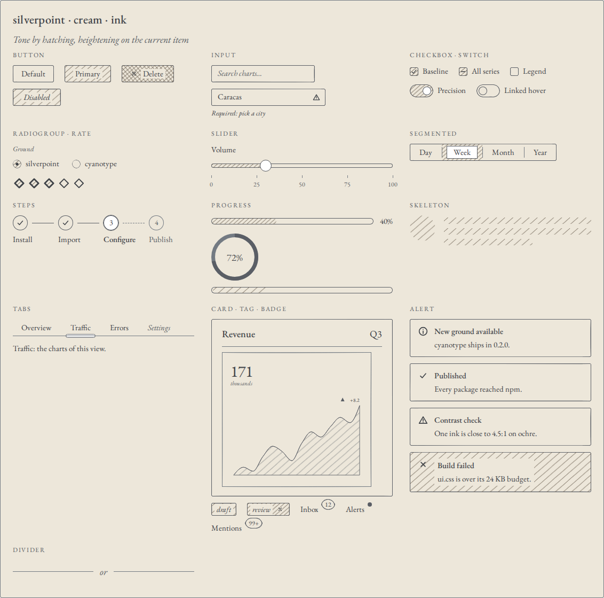
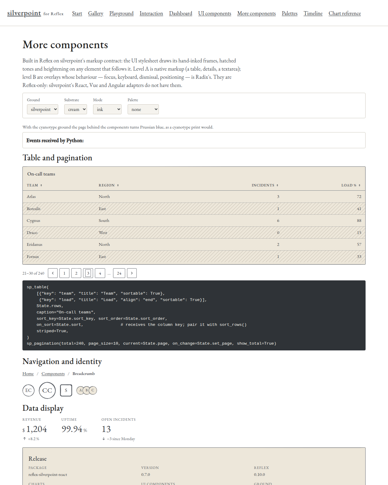
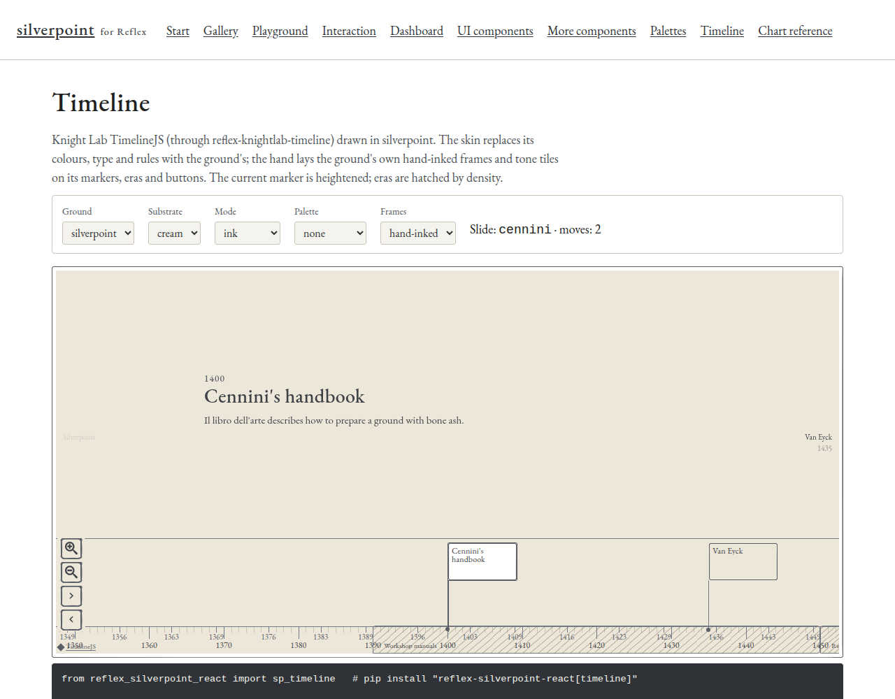
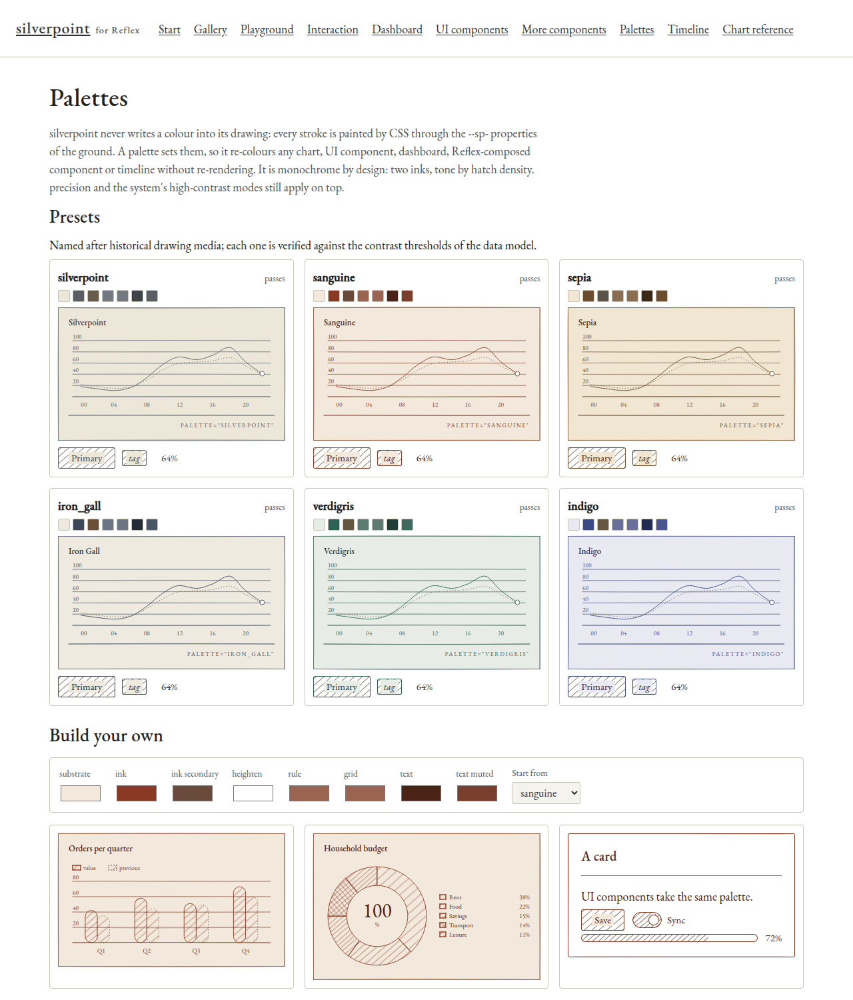
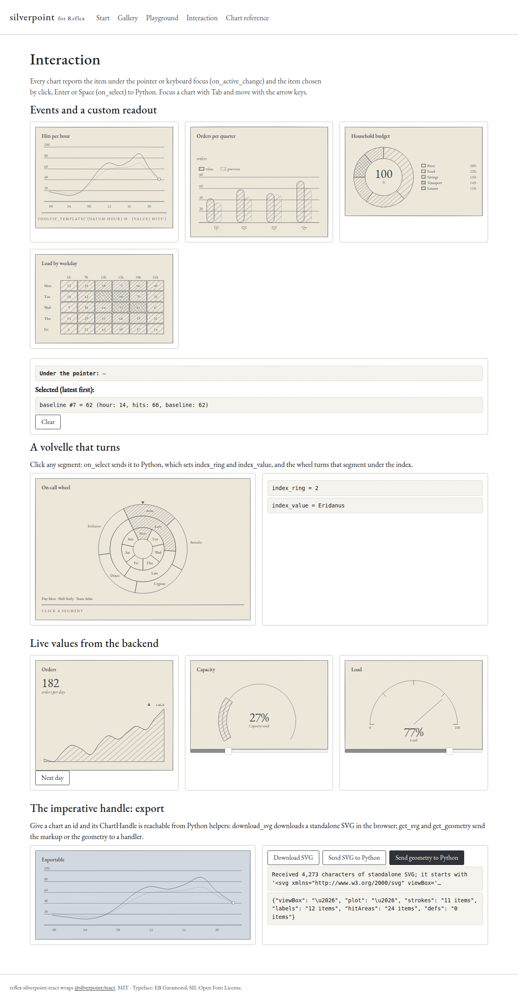

# reflex-silverpoint-react

A [Reflex](https://reflex.dev) custom component for **[silverpoint](https://github.com/ecrespo/silverpoint)**:
charts drawn in the manner of a Renaissance silverpoint drawing, with a fine silver line on a
prepared ground, tone built from hatching, and white heightening on the live value.

The hand-drawn irregularity lives only in the ornament. The data geometry is exact, and every chart
has a `precision` mode that turns the inking off.

It wraps [`@silverpoint/react`](https://www.npmjs.com/package/@silverpoint/react) **0.8.0** and exposes
**all 60 charts**, the **`Dashboard`** (a laid-out, linkable grid of charts), the **17 UI
components** (buttons, inputs, tabs, cards, alerts…), the **12 composed components** (table,
pagination, breadcrumb, avatar…), the **7 overlays** and the toaster (modal, drawer, popover,
tooltip, select, dropdown menu, toast), the **palettes**, the **Knight Lab timeline**, the
`SilverpointProvider`, both grounds (`silverpoint` and `cyanotype`), the interaction events, custom
readouts and the imperative handle (SVG export and geometry) as Python.

Everything it renders is an npm component of silverpoint, under its parity contract: the same
markup React, Vue and Angular render.

### New in 0.8.0

- Wraps **`@silverpoint/react` 0.8.0**. silverpoint 0.8 adds agent access and changes no API this
  package wraps, so the Python builders are unchanged.
- **Agent access:** the `reflex-silverpoint` skill, a Claude plugin with the hosted silverpoint MCP
  server, and `reflex-catalog.json`, the Reflex catalog silverpoint's agent catalog joins. See
  [Use with AI](#use-with-ai).

### New in 0.7.1

- Wraps **`@silverpoint/react` 0.7.0** (0.7.0 wrapped 0.6.0). silverpoint 0.7 took this package's
  palettes, composed components, overlays and timeline into the library itself, so they are now the
  npm components, not Reflex-composed copies: same Python builders, the library's markup.
- **Palettes** are the npm `palette` prop: they merge element → dashboard → provider field by field,
  `silverpoint_provider(palette=...)` works, and `silverpoint_palette(...)` is a provider with a
  palette. `check_palette()` measures the core's nine contrast pairs (the focus ring and the white
  heightening included); `"ironGall"` names the `iron_gall` preset too.
- **Composed components and overlays read `silverpoint_provider`**, as the `Sp` components do.
  Overlays are a native `<dialog>` and the Popover API (no Radix); they render in place, so a
  section's palette reaches them.
- **Logical sides**: `side="start"`/`"end"` and `position="bottom-end"`…; `left`/`right` still work
  with a `DeprecationWarning`. `sp_drawer(size=)` is `extent=`, `sp_popover(side_offset=)` is
  `offset=`; `sp_modal` gains `label` and `dismissible`, `sp_result`/`sp_descriptions`
  `heading_level`.
- `sp_textarea(textarea_id=)` and `sp_input_number(input_id=)` are `id=` (deprecated aliases kept);
  `sp_textarea` has no `on_blur`. `sp_collapse_item(on_toggle=)` receives the new open state (a bool).
- **`sp_timeline`** is the npm `SpTimeline`: TimelineJS is an npm dependency of that component, so the
  `[timeline]` extra pulls in nothing any more (it is kept so existing installs keep working).
- `sort_rows()` follows the core's `uiSortRows` order (numbers first, then text by code point).

### New in 0.7.0

- **Reflex 0.10.0**, and therefore **Python 3.11 or later** (Python 3.10 is no longer supported).
  Reflex 0.10 removed `reflex component build`: stubs are regenerated with `scripts/make_stubs.py`.
- **Palettes** — `palette=` on every chart, UI component, dashboard and composed component,
  `silverpoint_palette(...)` for a whole section, six presets named after drawing media
  (`silverpoint`, `sanguine`, `sepia`, `iron_gall`, `verdigris`, `indigo`) and `check_palette()`
  against the contrast thresholds of the data model. See [Palettes](#palettes).
- **Composed components, level A** (native markup): `sp_table` (+ `sort_rows`), `sp_pagination`,
  `sp_breadcrumb`, `sp_avatar` (+ `sp_avatar_group`), `sp_statistic`, `sp_descriptions`,
  `sp_timeline_list`, `sp_collapse` (+ `sp_collapse_item`), `sp_empty`, `sp_result`, `sp_textarea`
  and `sp_input_number`.
- **Composed components, level B** (overlays on Radix primitives): `sp_modal`, `sp_drawer`,
  `sp_popover`, `sp_tooltip`, `sp_select`, `sp_dropdown_menu` and `sp_toast` (+ `sp_toaster`), with
  `sp_trigger` as their drawn button. See [Composed components](#composed-components).
- **`sp_timeline`** — Knight Lab TimelineJS drawn in silverpoint: a skin on the ground's colours and
  type, plus the ground's own hand-inked frames and tone tiles on its markers, eras and buttons.
  Optional extra (until 0.7.1): `pip install "reflex-silverpoint-react[timeline]"`. See [Timeline](#timeline).
- `sp_surface`, `sp_glyph`: the building blocks, for components of your own.

### New in 0.6

- **27 new charts**, the second catalog of silverpoint 0.6:
  - distributions & comparisons: `histogram_chart`, `ecdf_chart`, `box_plot_chart`, `violin_chart`,
    `ridgeline_chart`, `beeswarm_chart`, `lollipop_chart`, `dumbbell_chart`, `slope_chart`,
    `bump_chart`, `error_bar_chart`, `interval_chart`, `diverging_bar_chart`, `connected_scatter_chart`;
  - hierarchies & dimensions: `waffle_chart`, `marimekko_chart`, `squarified_treemap`,
    `sunburst_chart`, `tree_chart`, `parallel_coordinates_chart`, `polar_line_chart`,
    `polar_scatter_chart`;
  - fields & networks: `density_bin_chart`, `contour_chart`, `delaunay_chart`, `vector_field_chart`,
    `network_chart` (with the `network_node` helper).
- **Drill-down** on `squarified_treemap` and `sunburst_chart`: `root_id` plus the `on_root_change`
  event. See [Drill-down](#drill-down).

### New in 0.3

- **17 UI components**, drawn as the charts are: `sp_button`, `sp_input`, `sp_checkbox`,
  `sp_switch`, `sp_radio_group`, `sp_slider`, `sp_rate`, `sp_segmented`, `sp_tabs` (with
  `sp_tab_panel`), `sp_steps`, `sp_card`, `sp_tag`, `sp_badge`, `sp_divider`, `sp_progress`,
  `sp_alert` and `sp_skeleton`. Native controls underneath, controlled from Python. See
  [UI components](#ui-components).
- `UI_COMPONENTS` and `UI_DEMOS`: the catalog's 17 components, their 45 reference states, and
  `ui_demo(slug, state)` to render any of them.
- `substrate="prussian"` is accepted everywhere (the `cyanotype` ground's substrate).

### New in 0.2

- **`dashboard`**, **`dashboard_cell`** and **`dashboard_link`**: a titled grid of cards laid out from
  a data-only layout, charts sized to their cells, and charts linked on a datum field.
- **The `cyanotype` ground**: a white line on Prussian blue. Tone is the weight of an exact line, so
  nothing is hatched. Use `ground="cyanotype"` on a chart, the provider or a dashboard.



## Installation

```bash
pip install reflex-silverpoint-react
# or
uv add reflex-silverpoint-react
```

Nothing else to do on the JavaScript side: Reflex installs `@silverpoint/react`,
`@silverpoint/core`, `@silverpoint/grounds` and `@silverpoint/fonts`, and every chart imports the two
stylesheets it needs (`@silverpoint/grounds/styles.css` and the self-hosted EB Garamond of
`@silverpoint/fonts/fonts.css`); the UI components also import `@silverpoint/grounds/ui.css`. No
Tailwind, no CDN.

Requires Reflex 0.10.0 or later (React 19) and Python 3.11 or later.

## Quickstart

```python
import reflex as rx
from reflex_silverpoint_react import line_chart

DATA = [
    {"hour": "00", "hits": 18},
    {"hour": "04", "hits": 11},
    {"hour": "08", "hits": 42},
    {"hour": "12", "hits": 64},
    {"hour": "16", "hits": 57},
    {"hour": "20", "hits": 30},
]


def index() -> rx.Component:
    return rx.box(
        line_chart(data=DATA, x_key="hour", value_key="hits", title="Hits per hour"),
        width="480px",
    )


app = rx.App()
app.add_page(index)
```

The chart takes the width of its container; `height` is the height of the drawing area (160 px by
default). Omit `data` and a chart draws its own demo dataset.

Props are the React props in `snake_case`: `xKey` → `x_key`, `hatchFill` → `hatch_fill`,
`footerRight` → `footer_right`, `centerLabel` → `center_label`, and so on. `data` and every prop can
be a Reflex state var.

## The 60 charts

| Family | Charts |
|---|---|
| Lines | `line_chart`, `step_chart`, `sparkline_rows`, `kpi_card` |
| Bars | `bar_chart`, `stacked_bar_chart`, `composed_chart`, `waterfall_chart`, `funnel_chart`, `bullet_chart`, `pyramid_chart`, `candlestick_chart` |
| Areas | `area_chart`, `range_band_chart`, `stream_chart` |
| Points & grids | `scatter_chart`, `bubble_chart`, `heatmap_chart`, `treemap_chart`, `activity_grid` |
| Flows | `sankey_chart`, `chord_ring` |
| Radial | `donut_chart`, `radar_chart`, `polar_bar_chart`, `radial_arc_group`, `radial_rings`, `gauge_arc`, `meter_chart`, `coxcomb_chart`, `wind_rose`, `volvelle_chart`, `orbit_chart` |
| Distributions & comparisons (0.6) | `histogram_chart`, `ecdf_chart`, `box_plot_chart`, `violin_chart`, `ridgeline_chart`, `beeswarm_chart`, `lollipop_chart`, `dumbbell_chart`, `slope_chart`, `bump_chart`, `error_bar_chart`, `interval_chart`, `diverging_bar_chart`, `connected_scatter_chart` |
| Hierarchies & dimensions (0.6) | `waffle_chart`, `marimekko_chart`, `squarified_treemap`, `sunburst_chart`, `tree_chart`, `parallel_coordinates_chart`, `polar_line_chart`, `polar_scatter_chart` |
| Fields & networks (0.6) | `density_bin_chart`, `contour_chart`, `delaunay_chart`, `vector_field_chart`, `network_chart` |

Every factory has a class of the same name in `PascalCase` (`LineChart`, `WindRose`…).
`reflex_silverpoint_react.CHARTS` is the whole catalog with each chart's family and the reference of
its own props (`COMMON_PROPS` holds the shared ones), handy for galleries and documentation.

With your own `data`, `ridgeline_chart` needs `group_key`, `diverging_bar_chart` needs `levels` (the
level columns, most negative first) and `parallel_coordinates_chart` needs `dimensions` (the columns,
in axis order). The demo datasets ignore them.

`network_chart` lays its nodes out by force, the same on the server and in every browser for a given
`seed`. Pass `nodes` to name and group them, built with `network_node`. A node with an `x` and a `y`
is drawn there, and when every node has both no layout runs:

```python
from reflex_silverpoint_react import network_chart, network_node

network_chart(
    data=State.links,  # [{"source": "a", "target": "b", "weight": 3}, ...]
    source_key="source",
    target_key="target",
    value_key="weight",
    nodes=[network_node("a", label="Archive", group="storage"), network_node("b", label="Billing")],
)
```

### Drill-down

`squarified_treemap` and `sunburst_chart` drill down under your control. The chart keeps no root of
its own: a click, Enter or Space on a node sends its id to `on_root_change` (the parent's id from the
centre or the frame, `None` at the top), and you pass it back as `root_id`:

```python
class Budget(rx.State):
    root: str | None = None

    @rx.event
    def drill(self, node_id: str | None):
        self.root = node_id


squarified_treemap(
    data=rows,  # one row per node: {"id": ..., "parent": ... or None, "name": ..., "amount": ...}
    id_key="id",
    parent_key="parent",
    label_key="name",
    value_key="amount",
    root_id=Budget.root,
    on_root_change=Budget.drill,
)
```

## Props every chart shares

| Prop | Default | |
|---|---|---|
| `data` | demo dataset | The rows to draw: a list of dicts. Without it, the accessor props (`*_key`, `keys`, `names`) are ignored. |
| `ground` / `substrate` / `mode` | `"silverpoint"` / `"cream"` / `"ink"` | Style. Grounds: `silverpoint` and `cyanotype`. The `silverpoint` substrates are `cream`, `green`, `blue` and `ochre`; `cyanotype` has one, `prussian`, whatever substrate a chart names. `mode="precision"` turns the inking off. |
| `seed`, `id` | derived, stable | The hand drawing is deterministic: same props, same strokes. |
| `height`, `width` | `160`, container width | Size of the drawing area in px. |
| `chrome` | `"card"` | `"bare"` draws only the plot. |
| `title`, `badge`, `value`, `unit`, `footer_left`, `footer_right` | — | The card's text. |
| `label`, `description`, `data_table` | from `title`, —, `"hidden"` | Accessibility. |
| `locale`, `number_format` | environment | Number formatting (`number_format` is a dict of `Intl.NumberFormatOptions`). |
| `hatch_fill` | `"tile"` | `"per-shape"` gives richer hatching at a much greater weight. |
| `tooltip` | built-in readout | A custom readout; see `tooltip_template`. |
| `on_active_change`, `on_select` | — | Events; see below. |

## One ground for the whole app

```python
from reflex_silverpoint_react import bar_chart, donut_chart, silverpoint_provider

silverpoint_provider(
    bar_chart(data=sales, x_key="month", value_key="units", title="Units sold", unit="units"),
    donut_chart(data=channels, name_key="channel", value_key="share", title="Sales by channel", center_label="%"),
    ground="silverpoint",
    substrate="green",
    locale="en-GB",
)
```

A prop on a chart always wins over the provider. The provider's props can be state vars, so one
select can re-ground a whole dashboard.

## Dashboards

`dashboard` lays charts out in a titled grid. The layout is plain data: the number of columns, each
cell's column and row spans (per breakpoint if you like), the row height and the gap. The
breakpoints are the dashboard's own width: `sm` below 640 px, `md` up to 1024 px, and `lg` above.
The defaults are 1, 2 and 4 columns. Each chart is sized to its cell, and `ground`, `substrate`,
`mode` and `locale` pass to every chart inside.

```python
from reflex_silverpoint_react import (
    bar_chart,
    dashboard,
    dashboard_cell,
    dashboard_cell_layout,
    dashboard_layout,
    kpi_card,
    line_chart,
)

dashboard(
    dashboard_cell(kpi_card(title="Revenue", metric="thousands", delta=6.4), cell="revenue"),
    dashboard_cell(line_chart(data=State.ops, x_key="hour", value_key="hits", title="Traffic"), cell="traffic"),
    dashboard_cell(bar_chart(data=State.ops, x_key="hour", value_key="errors", title="Errors"), cell="errors"),
    id="ops",  # required
    title="Operations",  # or label=... for no visible heading
    description="Service health over the last day.",
    layout=dashboard_layout(
        ["revenue", dashboard_cell_layout("traffic", col_span={"md": 2, "lg": 3}, row_span=2), "errors"],
        columns={"sm": 1, "md": 2, "lg": 4},
        row_height=240,
        gap=16,
    ),
    link="hour",  # link the charts on the rows' "hour" field
    on_link_change=State.on_link,  # {"key": "hour", "value": "18"}, or None when it clears
)
```

- `dashboard_cell(chart, cell="id")` puts a chart in a named layout cell. Children without one follow
  the named cells, in source order, with span 1.
- With `link`, pointing at or focusing an item in one chart marks every item in the other charts
  that has the same value in that field. `dashboard_link(..., link="hour")` does the same for charts
  you lay out yourself, outside a dashboard grid.
- `heading_level` (2-6) sets the title's heading level. `ssr_width` is the width the grid is laid
  out for before the browser measures it.
- `dashboard_layout` and `dashboard_cell_layout` write the camelCase keys the component reads. You
  can also pass a plain dict.
- The layout values and the charts' props can be state vars.

## UI components

New in silverpoint 0.3: seventeen interface components with frames hand-drawn by each ground's own
inker and tone laid as hatching (`silverpoint`) or as the weight of an exact white line
(`cyanotype`). Each is a native control underneath (a `<button>`, an `<input>`, a `<fieldset>` of
radios), so forms submit natively and the keyboard follows the WAI-ARIA patterns. They are imported
from `@silverpoint/react/ui`.



| Group | Components |
|---|---|
| Actions | `sp_button` |
| Data entry | `sp_input`, `sp_checkbox`, `sp_radio_group`, `sp_switch`, `sp_slider`, `sp_rate`, `sp_segmented` |
| Navigation | `sp_tabs` + `sp_tab_panel`, `sp_steps` |
| Data display | `sp_card`, `sp_tag`, `sp_badge`, `sp_divider` |
| Feedback | `sp_progress`, `sp_alert`, `sp_skeleton` |

```python
from reflex_silverpoint_react import sp_button, sp_input, sp_switch, sp_tab_panel, sp_tabs, ui_item


class State(rx.State):
    city: str = "Caracas"
    precision: bool = False
    view: str = "traffic"

    @rx.event
    def set_city(self, value: str):  # on_change gets the value, not an event
        self.city = value

    @rx.event
    def set_precision(self, value: bool):
        self.precision = value

    @rx.event
    def set_view(self, value: str):
        self.view = value

    @rx.event
    def save(self, form: dict):
        print(form)  # {"city": "Caracas", ...}: the native inputs submit under their name


rx.el.form(
    sp_input(
        label="City",
        name="city",
        value=State.city,
        on_change=State.set_city,
        invalid=State.city == "",
        message="Required: pick a city",
    ),
    sp_switch(label="Precision", checked=State.precision, on_change=State.set_precision),
    sp_tabs(
        sp_tab_panel(line_chart(...), value="traffic"),
        sp_tab_panel(bar_chart(...), value="errors"),
        items=[ui_item("traffic", "Traffic"), ui_item("errors", "Errors")],
        value=State.view,
        on_change=State.set_view,
    ),
    sp_button("Save", type="submit", variant="primary"),
    on_submit=State.save,
)
```

- **Shared props**: `id`, `ground`, `substrate`, `mode`, `seed`, `size` (`sm`/`md`/`lg`) and
  `class_name`. Like charts, they fall back to the dashboard, then to `silverpoint_provider`.
- **Values**: value components are controlled (`value=` / `checked=` with `on_change`) or
  uncontrolled (`default_value=` / `default_checked=`). `on_change` receives the new value itself (a
  string, a bool or a number), never a DOM event.
- **Items**: `ui_item(key, label, disabled=False)` for tabs, segmented and radio groups;
  `step_item(key, title, description=None, status=None)` for steps.
- **Slots**: children are a button's or tag's text, a card's or alert's body; `sp_card` also takes
  `extra` and `footer`, and `sp_input` takes `prefix` and `suffix` (components or text).
- **Close events**: `sp_tag(closable=True, on_close=...)` and `sp_alert(closable=True, on_close=...)`.
- `UI_COMPONENTS` is the catalog (group, declared states, props reference) and `UI_DEMOS` the 45
  reference states upstream ships; `ui_demo("radio-group", "selected", ground="cyanotype")` renders
  one, uncontrolled.
- Text inputs controlled from state make a round trip per keystroke; for long text, prefer
  `default_value` and read the value on submit.

## Palettes

silverpoint never writes a colour into its drawing: every stroke and fill is painted by CSS through
the ground's `--sp-` custom properties. A palette sets them, so it re-colours without re-rendering.

```python
from reflex_silverpoint_react import PALETTES, Palette, bar_chart, check_palette, silverpoint_palette, sp_button

bar_chart(title="Orders", palette="sanguine")  # a preset
sp_button("Save", variant="primary", palette={"ink": "#2C6355"})  # a dict of fields
bar_chart(title="Orders", palette=State.palette)  # a state var holding a dict

MINE = Palette(substrate="#F2E8DC", ink="#8A3A24", ink_secondary="#6A4A3A", text="#4A2216")
assert not check_palette(MINE)  # [] when every field meets its contrast threshold

silverpoint_palette(dashboard(...), sp_card(...), palette="indigo")  # a whole section
```

Fields: `substrate`, `ink`, `ink_secondary`, `heighten`, `rule`, `grid`, `text`, `text_muted` and
`focus` (the UI focus ring). Unset fields keep the ground's own. Palettes merge field by field,
element → dashboard → provider, so an element's own `palette` wins over its section's. A palette is
**monochrome by design**: tone is built from hatch density (Art. 6), so a chart has two inks (`ink`
for the main series, `ink_secondary` for the second), never a colour per series. `precision` mode and
the system's high-contrast modes still apply on top. `silverpoint_palette(...)` is
`silverpoint_provider(palette=...)` around the section.

## Composed components

silverpoint 0.7's composed components and overlays, the npm components of `@silverpoint/react/ui`:
native markup drawn by the core with the ground's hand-inked frames, hatched tones and
heightening, exactly as the `Sp` components are. Like them they read `silverpoint_provider` (and
the dashboard they sit in); a prop on the component always wins.

```python
from reflex_silverpoint_react import sort_rows, sp_pagination, sp_table

sp_table(
    [
        {"key": "team", "title": "Team", "sortable": True},
        {"key": "load", "title": "Load", "align": "end", "sortable": True},
    ],
    State.rows,
    caption="On-call teams",
    sort_key=State.sort_key,
    sort_order=State.sort_order,
    on_sort=State.sort,  # receives the key; sort with sort_rows(rows, key, order)
    striped=True,
)
sp_pagination(total=240, current=State.page, on_change=State.set_page, show_total=True)
```

| Composed (native markup) | |
|---|---|
| `sp_table` | Card-framed table: small-caps header, tabular figures, hatched striping, sortable headers with `aria-sort` |
| `sp_pagination` | Previous/next, first/last, a window around the current page (heightened); `on_change(page)` |
| `sp_breadcrumb` | `<nav>` of links; the last item is the current page |
| `sp_avatar`, `sp_avatar_group` | Portrait or initials in a drawn round (or square) frame |
| `sp_statistic` | Small-caps title, large tabular figure, prefix/suffix, trend arrow |
| `sp_descriptions` | Label–value grid (`<dl>`), optionally card-framed |
| `sp_timeline_list` | Vertical list: `done` (hatched), `current` (heightened), `pending`, `error` |
| `sp_collapse`, `sp_collapse_item` | Native `<details>`; `accordion=True` keeps one open |
| `sp_empty`, `sp_result` | Empty state; outcome with a drawn round mark |
| `sp_textarea`, `sp_input_number` | On the `SpInput` contract; `on_change` receives the value (text or number) |

| Overlays (`<dialog>`, Popover API) | |
|---|---|
| `sp_modal`, `sp_drawer` | Dialog on a card frame over a hatched backdrop; drawer from any edge |
| `sp_popover`, `sp_tooltip` | Anchored content; tooltip on hover or keyboard focus |
| `sp_select` | Single choice with typeahead; the chosen option ticked, the highlighted one heightened |
| `sp_dropdown_menu` | Commands with shortcuts, separators and labels; `on_select(key)` |
| `sp_toast`, `sp_toaster` | Notices that stack in a corner; `error`/`warning` are announced assertively |

Behaviour is the platform's: `showModal()` for the modal and the drawer (focus stays inside, Escape
and the backdrop close it unless `dismissible=False`), the Popover API for the rest (light
dismiss), keyboard and placement from `@silverpoint/core` (APG listbox and menu, typeahead, flip and
shift). Overlays render in place (the top layer, no portal), so a section's palette reaches them.
Sides are logical (`start`/`end`) and mirror in right-to-left text. An overlay clones its `trigger`
with its ARIA and a toggling click, so the trigger must keep the props it is given: a native
`rx.el.button`, or `sp_trigger(...)`, the drawn button strings become (`sp_button` drops them in
silverpoint 0.7.0). `sp_trigger` does not read the provider: give it `ground`, `substrate`, `mode`
and `palette`.

```python
sp_modal(
    rx.el.p("Apply the new ground?"),
    trigger="Open",
    title="Apply changes",
    footer=sp_trigger("Apply", variant="primary", on_click=State.confirm),
    open=State.modal_open,
    on_open_change=State.set_modal_open,
)
sp_select(["North", "East", "South", "West"], value=State.region, on_change=State.set_region)
sp_toaster(sp_toast("Saved", State.text, kind="success", open=State.toast_open, on_open_change=State.set_toast_open))
```



## Timeline

The npm `SpTimeline` of `@silverpoint/react/timeline`. TimelineJS (`@knight-lab/timelinejs` 3.9.13)
is an npm dependency of this component: Reflex installs it when a page uses `sp_timeline`, and no
Python extra is needed. If it cannot be loaded, the component warns `SP025` and renders `fallback`.

```python
from reflex_silverpoint_react import sp_timeline

sp_timeline(
    DATA,  # TimelineJS data: title, events, eras (or any object with to_dict())
    height=560,
    ground="silverpoint",
    substrate="cream",
    mode="ink",
    palette="sepia",
    inked_frames=True,  # the ground's hand-drawn frames and tone tiles
    on_change=State.on_change,  # the unique_id of the slide shown
)
```

It works in two layers. The **skin** replaces TimelineJS's colours, type and rules with the
ground's `--sp-` properties: substrate, inks, EB Garamond, hairline rules, eras hatched by density,
the current marker heightened. The **hand** reads the ground's own frame and tone masks from hidden
probes and lays them on the markers, eras and menubar, so they are drawn with the same pieces as
the `Sp` components; `inked_frames=False` keeps the skin only, and `precision`, `cyanotype` and
forced colours fall back to exact rules by themselves. Note that TimelineJS requests its icon font
from a relative path (`/css/icons/tl-icons.*`); the Reflex dev server answers it with HTML, so the
browser logs font-decoding warnings. They come from TimelineJS, not from this package.





## Interaction

```python
class State(rx.State):
    active: str = "—"

    @rx.event
    def on_active(self, item: dict | None):
        self.active = "—" if item is None else f"{item['datum']['hour']}: {item['value']}"

    @rx.event
    def on_select(self, item: dict):
        print("selected", item["datum"])


line_chart(
    data=DATA,
    x_key="hour",
    value_key="hits",
    on_active_change=State.on_active,
    on_select=State.on_select,
    tooltip=tooltip_template("{datum.hour} h · {value} hits"),
)
```

- `on_active_change` receives the item under the pointer or keyboard focus, and `None` when it
  leaves. `on_select` fires on click, `Enter` or `Space`. The item is
  `{"seriesKey", "index", "datum", "value", "point": {"x", "y"}}`.
- `tooltip_template(text)` builds the `tooltip` render function from a format string. Placeholders:
  `{heading}`, `{text}` (the built-in readout's two lines), `{announcement}`, `{value}`, `{index}`,
  `{series}` and `{datum.<field>}`. `{{` and `}}` print literal braces.

## Export: the imperative handle

Give a chart an `id` and its `ChartHandle` is reachable from Python:

```python
from reflex_silverpoint_react import download_svg, get_geometry, get_svg

line_chart(id="hits", data=DATA, x_key="hour", value_key="hits")

rx.button("Download SVG", on_click=download_svg("hits", "hits.svg"))  # in the browser
rx.button("SVG to Python", on_click=get_svg("hits", State.receive_svg))  # handler gets a str
rx.button("Geometry", on_click=get_geometry("hits", State.receive_geometry))  # handler gets a dict
```

The exported SVG carries its own ground colours, so it renders the same outside the app.

## Notes

- `volvelle_chart`: `index_ring` and `index_value` apply to your own rings, so pass `data` when you
  use them (the demo dataset keeps its own index).
- `gauge_arc` and `meter_chart` take `percent` (0-100) instead of `data`.
- Charts switch to `precision` by themselves under `prefers-contrast: more` or
  `forced-colors: active`; no prop overrides that.
- Accessors are field names (strings). The JavaScript API also accepts functions; from Python, shape
  your rows instead.

## Use with AI

An assistant writes better `reflex-silverpoint-react` code with the **`reflex-silverpoint` skill**
([`skills/reflex-silverpoint/`](skills/reflex-silverpoint/SKILL.md)): the builders and their
snake_case props, State patterns, event payloads, the provider and palettes, composed components and
overlays, the dashboard and the timeline. Its tables are generated from the package, and every Python
example in it is imported and rendered by the tests.

In Claude Code, the plugin installs the skill together with the hosted silverpoint MCP server
(`https://silverpointweb.vercel.app/mcp`), which recommends charts, checks props and draws a chart
as SVG before you write the code:

```text
/plugin marketplace add ecrespo/reflex-silverpoint-react
/plugin install reflex-silverpoint@reflex-silverpoint
```

The MCP server alone: `claude mcp add --transport http silverpoint https://silverpointweb.vercel.app/mcp`.

[`reflex-catalog.json`](reflex-catalog.json) is this package's catalog for agents: every chart and
component builder with its props (Python name, JS name and type), the deprecated arguments it still
accepts, the helpers, the package version and the silverpoint version it wraps. silverpoint's agent
catalog joins it, so its MCP tools answer with the Reflex names too. `scripts/export_catalog.py`
writes it, CI fails when it is stale, and each GitHub release carries it.

## Demo app

```bash
uv venv && uv pip install -e .
cd silverpoint_react_demo
uv run reflex run
```

Pages: **Start** (quickstart, provider, ink vs precision), **Gallery** (the 60 charts, ground
controls, demo datasets vs data from Python state with a re-roll), **Playground** (one chart, every
rendering choice and the Python that reproduces it), **Interaction** (events, custom readout, a
volvelle that turns on click, a treemap and a sunburst that drill down together, live
KPI/gauge/meter, SVG and geometry export), **Dashboard** (a
linked operations dashboard fed from Python state with ground, substrate, mode and column controls, a
KPI strip, and `dashboard_link` on its own), **UI components** (`/ui`: the components controlled from
Python state with a native form submit, and the three reference panels of the upstream example apps
in silverpoint ink, precision and cyanotype), one **reference page per chart** (`/chart/<slug>`) and
one per UI component (`/ui/<slug>`: every declared state on both grounds, usage and props). The
Gallery and Playground also get a ground control, for `cyanotype`, and a palette control.
New in 0.7: **More components** (`/components`: the 20 composed components wired to Python, with
ground, substrate, mode and palette controls and an event log), **Palettes** (`/palettes`: the
presets, a palette builder with colour pickers and `check_palette`, a coloured section) and
**Timeline** (`/timeline`: the Knight Lab timeline on every ground, mode and palette).



## Development

```bash
uv sync --extra dev
uv run pytest
uv run ruff check .
# Reflex 0.10 removed `reflex component build`: regenerate the .pyi stubs with the generator
# Reflex itself uses (plus this package's fixes), then build the sdist and wheel.
uv run python scripts/make_stubs.py
uv build
```

Before committing, run the hooks of [`.pre-commit-config.yaml`](.pre-commit-config.yaml) (ruff check
and format — including the Python blocks of this README — file hygiene and `uv lock --check`):

```bash
pre-commit install
pre-commit run --all-files
```

Changes per version are in [CHANGELOG.md](CHANGELOG.md); the guide for coding agents is
[AGENTS.md](AGENTS.md). Releases are published to PyPI by pushing a `vX.Y.Z` tag on `main` that
matches `version` in `pyproject.toml`.

## License

MIT. silverpoint is MIT; the EB Garamond typeface is under the SIL Open Font License.
